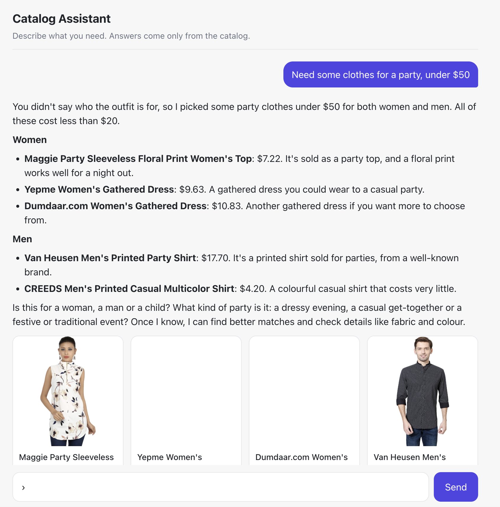
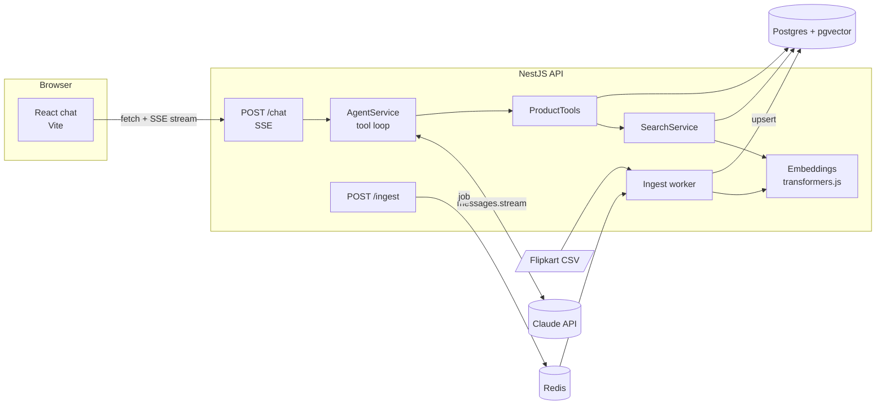

# Catalog Assistant

An AI shopping assistant for a product catalog. Ask in plain words ("a gift for a girl under $20", "anything cheaper?") and a Claude agent searches the catalog with tools, then streams back recommendations with product cards. Every product it shows comes from the database, never from the model's imagination.



## Features

- **Semantic search** over ~2,000 products with local embeddings (all-MiniLM-L6-v2) and pgvector (HNSW, cosine).
- **Claude agent with tools**: `search_products` (query, max price, category), `get_product_details`, `compare_products`. A hand-written tool loop with an iteration cap.
- **Streaming over SSE**: tool activity shows up as status ("Searching for …"), the answer streams token by token, and product cards come at the end.
- **Multi-turn conversations**: follow-ups like "anything cheaper?" keep the context.
- **Cost control**: token usage and cost per answer, per-IP rate limits, the paid Claude request is cancelled when the client disconnects.
- **Background ingestion**: a CSV import runs as a BullMQ job with retries, batching and an idempotent upsert.

## Architecture



**One chat request:**

1. The browser sends the whole conversation to `POST /chat`. The API is stateless; history lives on the client.
2. The agent calls Claude with the tools. When Claude asks for a tool, the API runs it (a vector search in Postgres, or a lookup by id) and sends the result back. This repeats, up to 6 iterations.
3. Each step is streamed to the browser as an SSE event: `tool`, `text`, `products`, `done` (with token usage and cost) or `error`.
4. Claude marks each recommended product with `[product:ID]`. The API returns cards only for ids that a tool actually returned, and the UI hides the markers.

## Tech stack

| Layer | Choice |
|---|---|
| API | NestJS 12 (ESM), Zod, `@nestjs/throttler` |
| AI | Anthropic SDK, Claude Opus 5.5 (configurable) |
| Search | Postgres 17 + pgvector (HNSW), Drizzle ORM |
| Embeddings | `@huggingface/transformers`, all-MiniLM-L6-v2 (384 dims), runs locally |
| Jobs | Redis + BullMQ (`@nestjs/bullmq`) |
| Web | React 19, Vite, react-markdown |
| Tests | Vitest |

## Running locally

Requirements: Node 24, Docker, an [Anthropic API key](https://console.anthropic.com/settings/keys).

```bash
# 1. Postgres + Redis
docker compose up -d

# 2. Dataset: download flipkart_com-ecommerce_sample.csv from
#    https://www.kaggle.com/datasets/PromptCloudHQ/flipkart-products
#    and put it in data/raw/

# 3. API
cd api
cp .env.example .env          # then set ANTHROPIC_API_KEY
npm install
npx drizzle-kit migrate       # creates the pgvector extension, table and HNSW index
npm run start:dev             # http://localhost:3000 (the embedding model downloads on first start)

# 4. Import products (in another terminal)
curl -X POST localhost:3000/ingest -H 'Content-Type: application/json' -d '{"limit":2000}'
curl localhost:3000/ingest/<jobId>   # progress

# 5. Web
cd ../web
npm install
npm run dev                   # http://localhost:5173, /api is proxied to :3000
```

### API

| Endpoint | Description |
|---|---|
| `POST /chat` | `{ messages: [{ role, content }] }` → `text/event-stream` |
| `GET /search?q=&maxPrice=&category=&limit=` | Semantic search without the LLM |
| `POST /ingest` | `{ limit? }` → `202 { jobId }` |
| `GET /ingest/:id` | Job state and progress |
| `GET /health` | Liveness + database check |

### Tests

```bash
cd api && npm test   # CSV parser, agent tool loop, iteration cap, abort on disconnect
cd web && npm test   # SSE parser (events split across chunks, 429 handling)
```

## Decisions & trade-offs

**Agent and LLM**

- **Hand-written tool loop instead of the SDK Tool Runner or `@nestjs/ai`.** About 80 lines, and it gives full control over streaming events, the iteration cap, cost accounting and cancellation. The trade-off is owning code a library would maintain.
- **Rules that the UI depends on are enforced in code, not only in the prompt.** The prompt asks Claude not to write before tool calls, but the model sometimes does; the UI treats text before a `tool` event as status. Cards come from `[product:ID]` markers, and only for ids returned by tools, so a hallucinated product can't get a card.
- **Tool results are untrusted data.** Product descriptions are third-party text. The system prompt tells Claude to ignore instructions inside them, and the UI renders Markdown to React elements, never raw HTML.
- **Cost.** With Opus 5.5 a typical question takes 2–3 iterations, about 4–5k input tokens, and costs $0.02–0.035. The iteration cap (6), history trimming (last 20 messages) and per-IP limits (10/min, 100/day) bound the worst case. `CLAUDE_MODEL` switches to Sonnet or Haiku.
- **Cancellation.** The chat handler is an async generator. When the client disconnects, Nest calls `return()` on it, and the agent's `finally` aborts the in-flight Claude request. A test covers this.

**Search and data**

- **Local embeddings.** No API key, no per-request cost, no data leaves the machine. The trade-off is quality: a small English model (384 dims) is weaker than hosted embedding models.
- **HNSW with filters.** pgvector applies `WHERE` filters (price, category) after the index finds candidates, so a narrow filter can return fewer results than asked for. With 2,000 products this doesn't show; at scale I'd enable `hnsw.iterative_scan` (pgvector 0.8) or pre-filter.
- **Prices are illustrative.** INR prices are converted to USD at a fixed rate (83) and stored as integer cents, so ingestion is deterministic.
- **Known quirk.** Vector search matches brand names, too: a brand called "Red" ranks high for queries about red items.

**Ingestion**

- **Streaming CSV parser as an async generator.** The file is read with backpressure, so memory stays flat no matter how large the CSV is.
- **Async request-reply.** `POST /ingest` returns `202` with a job id; the work runs in BullMQ with 3 attempts and exponential backoff. The upsert is idempotent (`ON CONFLICT DO UPDATE`), so a retried job doesn't create duplicates.
- **The worker runs in the API process** (`concurrency: 1`). Simpler to run; in production I'd move it to a separate process so embedding work doesn't take CPU from chat requests.

**Frontend**

- **`fetch` + `ReadableStream` instead of `EventSource`**, because `EventSource` only does GET and the chat needs a POST body. The parser buffers until a full `\n\n`-terminated event arrives.
- **View state ≠ API payload.** The UI keeps cards, errors and costs per message; only `{ role, content }` is sent to the API.
- **Vite proxy** (`/api` → `:3000`) keeps the browser on one origin, so the API needs no CORS setup.

## Limitations and next steps

- `POST /ingest` has no authentication; it would be an admin-only endpoint in a real deployment.
- Rate-limit counters live in process memory. With more than one instance they'd move to Redis.
- Not yet done: prompt caching for the system prompt and tools, a short description snippet in search results (fewer follow-up tool calls), an eval set comparing models, Docker images for the API and web.

## Dataset

Product data: [Flipkart Products](https://www.kaggle.com/datasets/PromptCloudHQ/flipkart-products) by PromptCloud, licensed under [CC BY-SA 4.0](https://creativecommons.org/licenses/by-sa/4.0/). The data is used for a demo: prices are converted and descriptions are cleaned and truncated during import. The dataset itself is not included in this repository.
